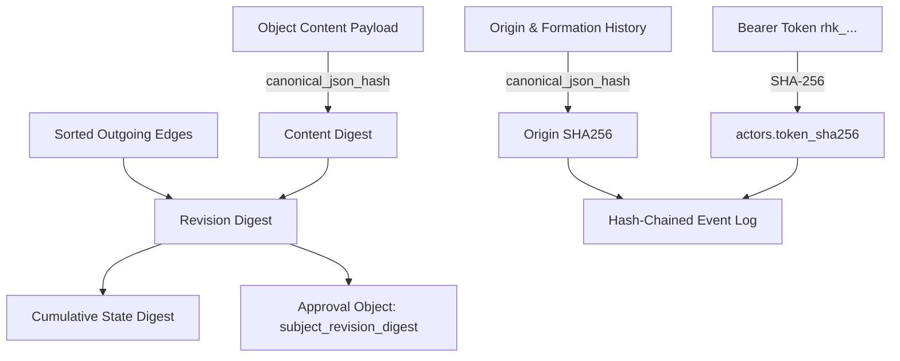

# Research Harness 9.0: Cryptographic Integrity Audit Specification

**Version:** 9.0.0  
**Effective Date:** 2026-10-18  
**Scope:** Cryptographic verification, hashing schemes, Merkle structures, Content-Addressed Storage (CAS), and actor attestation  

---

## 1. Cryptographic Primitive Definitions

All cryptographic digests throughout Research Harness 9.0 utilize standard **SHA-256** (FIPS 180-4) represented as 64-character lowercase hexadecimal strings (`^[0-9a-f]{64}$`).

### 1.1 Canonical Serialization
To guarantee deterministic hashing regardless of language runtime or operating system, serialization follows strict JSON canonicalization:
$$\text{canonical\_json}(x) = \text{json.dumps}(x, \text{sort\_keys}=\text{True}, \text{separators}=(',', ':'), \text{ensure\_ascii}=\text{False}).\text{encode}('utf-8')$$
$$\text{canonical\_json\_hash}(x) = \text{SHA-256}(\text{canonical\_json}(x)).\text{hexdigest}()$$

---

## 2. Integrity Dimensions & Chaining Invariants

Research Harness 9.0 establishes a multi-tiered cryptographic web connecting every object, relationship, actor mutation, and artifact blob.

### 2.1 Object Content Digest
- **Definition:** Cryptographic fingerprint of the scientific payload of an object revision.
- **Computation:**
  $$\text{content\_digest} = \text{canonical\_json\_hash}(\text{content})$$
- **Verification Rule:** `OBJECT_CONTENT_DIGEST_MISMATCH` is triggered if any byte of `content` in SQLite differs from `content_digest`.

### 2.2 Object Origin Digest
- **Definition:** Fingerprint of the provenance, creation context, and formation history (including HARKing declarations).
- **Computation:**
  $$\text{origin\_sha256} = \text{canonical\_json\_hash}(\text{origin})$$
- **Verification Rule:** `OBJECT_ORIGIN_DIGEST_MISMATCH` is triggered if `origin` metadata is modified.

### 2.3 Revision Digest & Edge Sealing
- **Definition:** Merkle root sealing the content digest combined with the exact set of sorted outgoing dependency edges.
- **Computation:**
  $$\text{revision\_digest} = \text{canonical\_json\_hash}\left(\left\{ \text{"content"}: \text{content\_digest}, \text{"edges"}: \text{sorted}([\text{relation}, \text{target\_id}, \text{target\_revision}]) \right\}\right)$$
- **Enforcement:**
  - Guaranteed at write time by database trigger `edges_sealed_at_revision_creation`.
  - Verified by audit rule `REVISION_DIGEST_MISMATCH`. Any late edge addition or edge deletion invalidates the revision digest.

### 2.4 Cumulative State Revision Digest
- **Definition:** Deterministic digest capturing the total active state of the project at a given state revision.
- **Computation:**
  $$\text{state\_sha256} = \text{canonical\_json\_hash}\left(\left\{ \text{"objects"}: \text{objects\_view}, \text{"edges"}: \text{edges\_view}, \text{"status"}: \text{status\_view}, \text{"heads"}: \text{heads\_view} \right\}\right)$$
- **Verification Rule:** `STATE_DIGEST_MISMATCH` is flagged if state tables deviate from `state_revisions.state_sha256`.

### 2.5 Hash-Chained Event Log
- **Definition:** Sequential, append-only ledger tracking every mutation event.
- **Computation:**
  $$\text{event\_sha256}_i = \text{canonical\_json\_hash}\left(\left\{ \text{"seq"}: i, \text{"event\_id"}: \text{eid}, \text{"state\_revision"}: r, \text{"event\_type"}: t, \text{"actor\_id"}: a, \text{"at"}: \text{timestamp}, \text{"payload"}: p, \text{"prev\_sha256"}: \text{event\_sha256}_{i-1} \right\}\right)$$
  - For $i = 1$, $\text{prev\_sha256} = \text{"0000000000000000000000000000000000000000000000000000000000000000"}$.
- **Verification Rules:** `EVENT_CHAIN_BROKEN`, `EVENT_SEQUENCE_INVALID`.

### 2.6 Cryptographic Approval Bindings
- **Definition:** An `Approval` object represents privileged human review authorization.
- **Binding Rule:**
  - The approval content must explicitly include `subject_revision_digest`.
  - The audit verifies that `subject_revision_digest` matches the live `revision_digest` of the target object.
  - If the target object is revised (bumping its revision digest), the approval remains anchored to the exact revision that was reviewed, and the new revision transitions to `NEEDS_REVIEW`.
- **Verification Rules:** `APPROVAL_TARGET_MISSING`, `APPROVAL_DIGEST_MISMATCH`, `APPROVAL_ACTOR_UNKNOWN`.

---

## 3. Content-Addressed Storage (CAS) Protocol

Binary artifacts, manuscript drafts, and raw proposal JSON payloads are stored in an immutable Content-Addressed Storage filesystem directory:
$$\text{Path: } \langle\text{project\_root}\rangle/\text{artifacts}/\text{sha256}/\langle\text{digest}[:2]\rangle/\langle\text{digest}\rangle$$

### 3.1 Two-Phase Atomic Publication Protocol
SQLite transactions cannot span raw filesystem file writes. To prevent dangling references or truncated files, the engine executes a strict three-step protocol:
1. **Stage:** File bytes are written to $\langle\text{project\_root}\rangle/\text{staging}/\langle\text{random}\rangle.\text{tmp}$. The file descriptor is flushed and explicitly synchronized to durable disk storage via `os.fsync`.
2. **Atomic Publish:** The temporary file is moved to its content-addressed path via atomic filesystem rename (`os.replace`). The filename *is* the SHA-256 hash.
3. **Commit:** Only after the file is published on disk does the SQLite write transaction execute, recording the artifact hash in metadata.

### 3.2 CAS Integrity Verification
- **`REFERENCED_ARTIFACT_MISSING`:** An object or proposal references an artifact digest, but the blob does not exist in CAS storage.
- **`ARTIFACT_BLOB_CORRUPT`:** A blob exists on disk, but recomputing its SHA-256 hash does not match its filename digest.
- **`ORPHAN_ARTIFACT_BLOB`:** An artifact blob exists on disk but is not referenced by any object or proposal. (Reported as an advisory `INFO` finding; reclaimable via `project recover`).

---

## 4. Actor Attestation & Zero-Disk Credentials

- **Token Hashing:** Bearer tokens are generated as `rhk_` prefixed cryptographically random strings (256-bit entropy). Only `SHA-256(token)` is persisted in SQLite (`actors.token_sha256`).
- **Zero Raw Credential Persistence:** Engine logs, proposal payloads, and state tables never record raw tokens or private HMAC keys.
- **Registry Attestation:** Every actor creation, role update, or revocation is committed to the immutable event log. The integrity audit verifies that replaying the event log matches the active `actors` table row-for-row (`ACTOR_EVENT_MISMATCH`).

---

## 5. External Anchor Protocol

To protect against offline hostile tampering with the SQLite database file:
1. **Periodic Git Commit Anchoring:** The `state_revisions.state_sha256` of major releases is signed using GPG/SSH and committed to an external Git repository.
2. **RFC 3161 Timestamping:** State digests may be submitted to an RFC 3161 Time-Stamp Authority (TSA) or public transparency log (e.g., Sigstore Rekor), proving that the research state existed in exactly that cryptographic configuration at that time.
